<p align="center">
  <a href="https://ctskool.github.io/claude-edit/">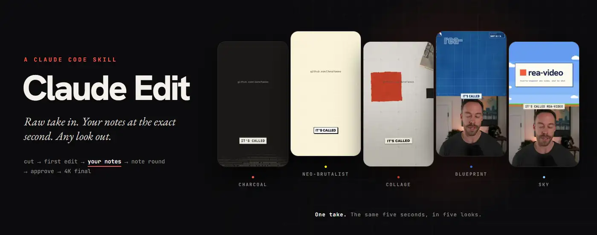</a>
</p>

<p align="center">
  <b>A Claude Code skill that edits your talking-head videos beat by beat.</b><br>
  You watch your own edit, pause on a frame and leave a note. Claude changes only what you noted.<br>
  Shorts in six looks, and 16:9 long-form.
</p>

<p align="center">
  
  
  
  
  
  
  
</p>

<p align="center">
  <a href="https://ctskool.github.io/claude-edit/"><b>Watch the gallery</b></a>
  &nbsp;·&nbsp;
  <a href="#one-take-any-look">Looks</a>
  &nbsp;·&nbsp;
  <a href="#how-an-edit-goes">How an edit goes</a>
  &nbsp;·&nbsp;
  <a href="#the-review-player">The player</a>
  &nbsp;·&nbsp;
  <a href="#long-form">Long-form</a>
  &nbsp;·&nbsp;
  <a href="#start-here">Start here</a>
  &nbsp;·&nbsp;
  <a href="INSTALL.md">Install</a>
</p>

## At a glance

| | |
|---|---|
| **You give it** | A raw talking-head take (or several). Your screen on top, your face cam below, or just your face |
| **You get** | A finished MP4: a vertical short in one of several looks (ivory, charcoal, neo-brutalist, collage, blueprint, sky), or a 16:9 long-form video. Cut tight, every beat edited, captioned and mastered |
| **Your part** | Listen to the cut in the cut review page and fix any join by ear, leave notes in the player wherever you want a change, then approve |
| **It stops for you** | After the cut, after every render, before sound, before the final. It never moves the picture while you're reviewing |
| **It never** | Invents a number, generates your body or face, or changes something you didn't note |

## One take, any look

The banner above is one real take: the same five seconds, edited five ways. The words, the cut and the timing are identical; only the look changes. Say the look when you hand over the take ("in collage", "the blueprint one"), or ask for a finished edit to be remade in another.

| Look | What it is | How it's built |
|---|---|---|
| **Ivory** | The default. Warm paper cards, serif numbers, real screenshots rebuilt sharp | Kit look |
| **Charcoal** | The same layout in near-black with one orange accent | Kit look |
| **Neo-brutalist** | Cream dot grid, outlined white cards with hard shadows, yellow highlights | Kit look |
| **Collage** | Torn paper, newsprint, halftone cut-outs | Kit look, with its own images and motion |
| **Blueprint** | The whole short as one engineering drawing a camera travels across | Written by hand per video |
| **Sky** | A 16-bit Claude acts the short out on a pixel sky; a finished one recolours into 20 skies (noir, storm, snow, sunset, Miami...) for posting variants | Written by hand per video; recolours with `looks/sky/skies.py` |

Kit looks share one build, so a finished edit can be remade in another kit look without redoing the edit, and a note re-renders only the beats it touched. Blueprint and sky are authored per video and re-render whole after a note (two to four minutes on the author's machine). All six go through the same cut review, the same player and the same Approve click.

## Raw take in, edited video out

<table>
<tr>
<td width="44%" valign="top"><a href="https://ctskool.github.io/claude-edit/">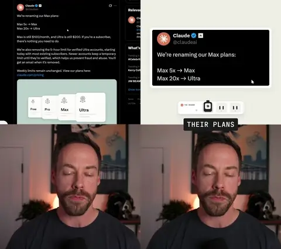</a></td>
<td valign="top">

```text
/claude-edit "C:/Users/you/Videos/take.mkv"
```

Left is the raw take. Right is the edit Claude made from it, on the same seconds with the same voice. This is a real short: 57 seconds, 29 beats, four rounds of notes, then approval, sound and the final. [Watch it with sound in the gallery](https://ctskool.github.io/claude-edit/).

- **It edits your real footage.** Your screen recording, your face cam, real screenshots of the pages you mention. It never invents a body, a face or a number.
- **Every number on screen has a source.** Claude checks each claim before it can appear, and anything it can't verify stays off the picture.
- **You react to a finished edit.** No picking styles or moves up front. You see the whole video edited, then say what to change.

</td>
</tr>
</table>

## How an edit goes

1. **Raw in.** Hand it one or more raw takes. Claude transcribes them on your computer, drops the failed takes, false starts and long pauses, and checks the cut by transcribing it again.
2. **The cut review.** A page opens that looks like a simple timeline: your camera on top, one row of clips below. You hear the tight cut, drag any join that sounds wrong, and approve. Nothing visual is final until you do. While you listen, Claude already checks the facts and captures the pages you mention.
3. **The first edit.** One agent checks the facts, plans every beat (which words land on what, which real screenshot or clip shows it, where the layout switches) and checks its own plan against a short list. It shows you stills of the hook and first step so you can steer early, then builds the whole video in your look and renders it at review quality.
4. **Its own defects round.** A fresh reviewer that never saw the plan looks at the rendered frames for broken frames, clipped text and anything that hides your face, and a script checks for one-frame jumps. Claude fixes what they find before you see it.
5. **Your notes, at exact seconds.** The review player opens in your browser. Pause where you want a change, press **N**, type. Each note is saved with the exact frame and the picture it was left on.
6. **The note round.** Say "go" in the chat. Claude maps each note to the one piece of source that drew that frame, changes only that, and re-renders only the beats it touched. Then you look again. Repeat as often as you like.
7. **Approval.** You approve in the player. Your click is the approval: the picture you watched is the one that gets finished, and the final starts by itself.
8. **Sound.** Claude places sound effects by what each moment does, levelled against your voice. You listen in the player and leave sound notes the same way.
9. **The final.** Built fresh from a frozen copy of the approved edit at 4K30 (1080p when your camera file isn't 4K), mastered, checked again, and handed to you as an MP4.

Claude also turns your notes into candidate rules for next time. Nothing becomes a rule until you mark it keep.

One agent plans and builds the whole edit, and one fresh reviewer checks the frames. On the author's test video that took 40 minutes from the raw take. You can also hand over a reference video and say whether you want its whole look or specific things.

Some stages are newer than others; [status.md](.claude/skills/claude-edit/status.md) says which have run on real videos.

## The review player

<p align="center">
  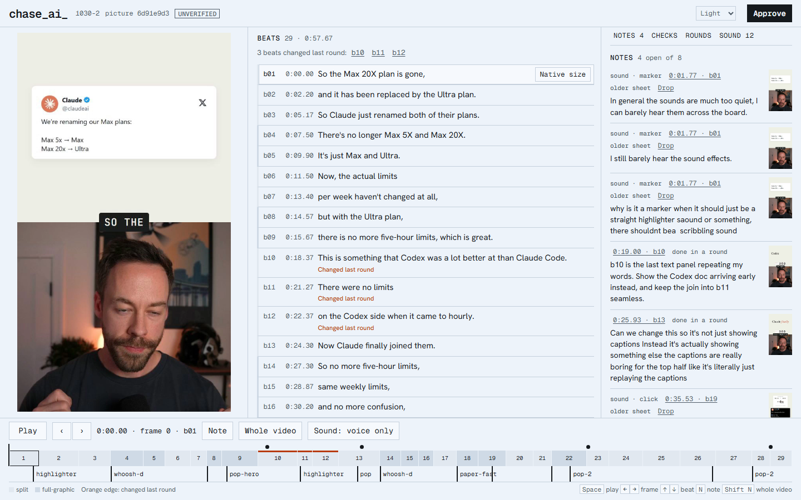
</p>

<table>
<tr>
<td width="56%" valign="top"><a href="https://ctskool.github.io/claude-edit/">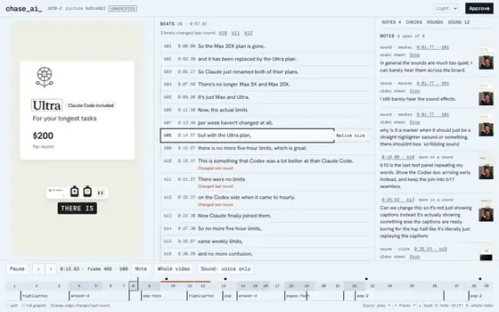</a></td>
<td valign="top">

- **The edit on the left, every beat in the middle, your notes on the right.** Click a beat to jump to it. The beats Claude changed last round are marked.
- **Notes stay attached to their frame.** If you go back to an earlier round, notes left on a later picture come back to you as questions, never applied silently.
- **Checks you can see.** Anything the automatic checks failed shows in the player. Only you can waive it, with a click.
- **A page can't wake Claude,** so you say "go" in the chat when your notes are ready.

The default look is the light grey above. Optional looks live in [`tools/beat_review_v2/skins/`](tools/beat_review_v2/skins): add `?skin=<name>` to the address.

</td>
</tr>
</table>

## Long-form

<p align="center">
  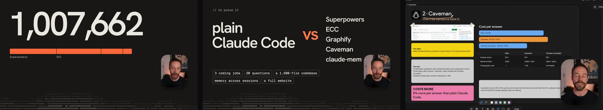
</p>

The `charcoal` template edits a widescreen YouTube video: your screen recording plus your camera, minutes long.

1. **Same cut, same review page**, with your timing notes before any graphic exists.
2. **A stills storyboard** of the whole video, approved before anything renders.
3. **A pilot** of the intro and first chapter in the player.
4. **The build:** your screen full frame with your face in a corner, or your camera full frame, and a designed graphic for each idea.
5. **Notes by segment** in the player. Rendering is by slice, so a note on one graphic re-renders that slice, not the video.
6. **The 4K final**, with chapters and captions for the upload.

It is built by hand from one page, [`templates/charcoal/CARD.md`](templates/charcoal/CARD.md). Four of the author's videos have gone through it.

## What it reuses

Every approved edit adds the components it proved to a library, so the next edit can start from them. These came out of the edit above.

<!-- gallery:start -->

### Proven components

Each one came out of an approved edit, so the next edit can start from it. They live in templates/ivory/library/.

<table>
<tr>
<td width="33%" align="center" valign="top">
<a href="https://ctskool.github.io/claude-edit/">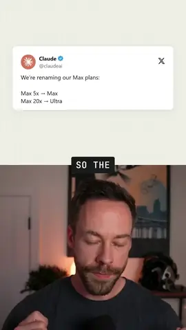</a>
<br><b>Post card</b><br><sub>The real post, rebuilt sharp on an ivory card, with the old name struck out</sub>
</td>
<td width="33%" align="center" valign="top">
<a href="https://ctskool.github.io/claude-edit/">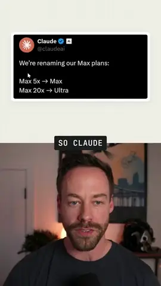</a>
<br><b>Clip card</b><br><sub>A piece of his own screen recording on a card, with the running strip popping in</sub>
</td>
<td width="33%" align="center" valign="top">
<a href="https://ctskool.github.io/claude-edit/">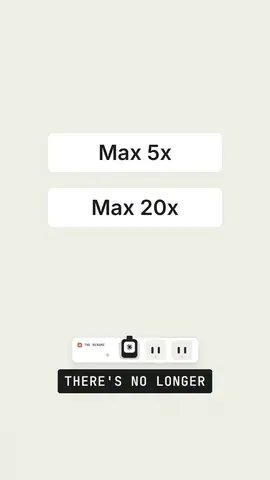</a>
<br><b>Before and after</b><br><sub>Two built pills for the old names, struck through as the new ones land</sub>
</td>
</tr>
<tr>
<td width="33%" align="center" valign="top">
<a href="https://ctskool.github.io/claude-edit/">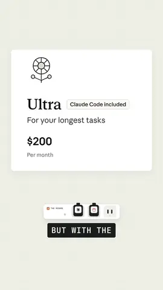</a>
<br><b>Stacked capture</b><br><sub>One real plan card from the pricing page, zoomed, with a drawn outline</sub>
</td>
<td width="33%" align="center" valign="top">
<a href="https://ctskool.github.io/claude-edit/">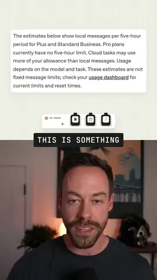</a>
<br><b>Docs card</b><br><sub>The real help page on a white card, one phrase outlined as he says it</sub>
</td>
<td width="33%" align="center" valign="top">
<a href="https://ctskool.github.io/claude-edit/">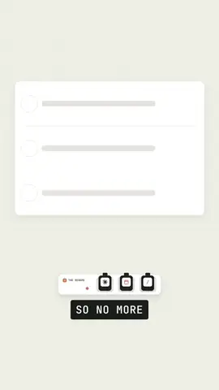</a>
<br><b>List card</b><br><sub>Rows that check off one by one, each with a crop of the real post</sub>
</td>
</tr>
<tr>
<td width="33%" align="center" valign="top">
<a href="https://ctskool.github.io/claude-edit/">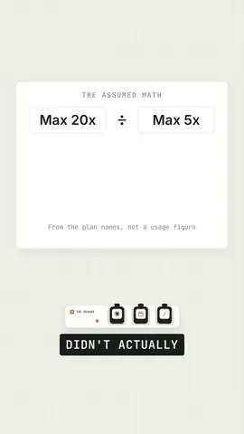</a>
<br><b>Number card</b><br><sub>An equation in pills and a big serif figure, struck when he corrects it</sub>
</td>
<td width="33%" align="center" valign="top">
<a href="https://ctskool.github.io/claude-edit/">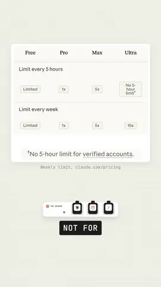</a>
<br><b>Compare table</b><br><sub>The real pricing table with pill outlines, a drawn bracket and its footnote</sub>
</td>
<td width="33%" align="center" valign="top">
<a href="https://ctskool.github.io/claude-edit/">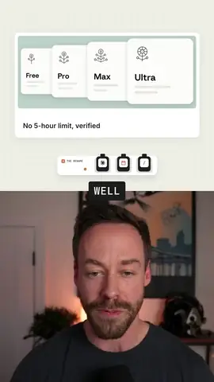</a>
<br><b>Art card</b><br><sub>The post's own art, pushing in on the new plan as he names it</sub>
</td>
</tr>
</table>

### Coming next

<table>
<tr>
<td width="33%" align="center" valign="top">
<sub><i>In note rounds now</i></sub>
<br><b>Top five skills</b><br><sub>The second edit through the whole flow, added once it's approved</sub>
</td>
</tr>
</table>

<!-- gallery:end -->

## Start here

One command installs it for every folder on your machine. It puts the editor in `~/claude-edit`, builds its Python and Node environments there, and adds the `/claude-edit` skill to your Claude Code, so you can open Claude Code anywhere.

Windows (PowerShell):

```powershell
irm https://raw.githubusercontent.com/ctskool/claude-edit/main/install.ps1 | iex
```

macOS (Terminal):

```bash
curl -fsSL https://raw.githubusercontent.com/ctskool/claude-edit/main/install.sh | bash
```

It needs Claude Code, Python 3.10+, Node.js 22+, git and ffmpeg already installed, and tells you the install command for any that are missing. Run it again to update. Then, in Claude Code, in any folder:

```text
/claude-edit "C:/path/to/your/take.mkv"
```

Your edits and finals are kept in `~/claude-edit`, and each final is also copied next to your take. [INSTALL.md](INSTALL.md) has the system software, the manual steps and the optional extras.

**What to record.** For today's vertical template, a vertical take with your screen in the top half and your face cam in the bottom half, the way Chase records in OBS. A separate full-quality camera file beside it is optional. A plain face-only take works too: say so at the start.

**Effects from Chase Animations.** `/animate` and `/vfx` come from the separate [Chase Animations](https://github.com/ctskool/chase-animations) pack, installed with its `npm run setup`. With it installed, a note in the player can call one, like "put the orbit here", and Claude drops its real render into that beat.

**Codex is optional.** With [Codex](https://github.com/openai/codex) installed, Claude can generate scene images and a second model joins the defects round. Without it, every beat uses real captures and built cards, and two Claude reviewers run instead.

## How it's built

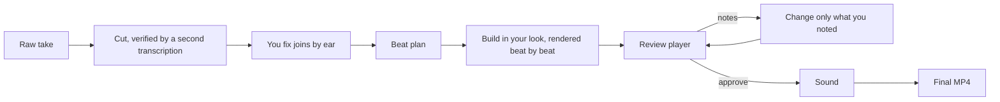

| Folder | What's in it |
|---|---|
| [`.claude/skills/claude-edit/`](.claude/skills/claude-edit/SKILL.md) | The skill: every stage, its checks and its stop points |
| [`templates/`](templates) | The house rules, the story rules for cutting, the ivory template with its build kit, looks, sound palette and component library, and the charcoal long-form template |
| [`tools/`](tools) | The cutter, transcription, the cut review page, beat renderer, checks, review player, sound mixer and delivery |
| [`tools/workflows/next/`](tools/workflows/next) | The sound workflow the skill runs |
| [`examples/ivory-edit/`](examples/ivory-edit) | The text files of the approved edit above: how a plan becomes an edit |
| [`styles/editorial/`](styles/editorial) | The measured look behind ivory |
| [`references/`](references) | How to measure a reel you like, so its ideas (not its look) can reach your edit |
| [`docs/`](docs) | The gallery page and its catalogue |
| [`scripts/`](scripts) | Builders for the gallery, banner and player capture. Not needed to edit |

## What works where

| | Status |
|---|---|
| Windows 11 | Tested. One raw take has gone the whole way, to an approved, sounded final |
| Mac | **Partly tested** on an Apple Silicon MacBook Air: install, doctor, all tests, transcription on the CPU, the cut and source prep. A whole edit with the review player hasn't run on a Mac yet. Install `ffmpeg-full` from Homebrew, not `ffmpeg`. [Open an issue](https://github.com/ctskool/claude-edit/issues) and say how it goes |
| Linux | Untested |
| Widescreen (16:9 long-form) | Ships as the `charcoal` template, built by hand from [`templates/charcoal/CARD.md`](templates/charcoal/CARD.md). Four of the author's videos went through it on Windows with an NVIDIA card. Without one it renders in software (`render_slices_x264.py`, picked automatically), which is slower and has not been timed on another machine |
| No NVIDIA card | Shorts: everything runs (transcription on the CPU with a smaller model, renders in the browser, encodes with libx264); only the popout bottom needs NVIDIA. Long-form: the software renderer. Expect renders several times slower than the author's times |
| Mac speed | On an Apple Silicon Mac the installer adds `mlx-whisper`, so transcription runs on the Mac's own GPU instead of the CPU; the cutter decodes your camera file on Apple's hardware decoder and the cut review page's preview uses Apple's hardware encoder. Each falls back to the CPU route by itself if it fails. **Written on Windows and not yet run on a Mac.** Finals and long-form still encode in software on a Mac |
| Final size | 4K30 when your camera recording is 4K, 1080p30 otherwise. A 4K final of a one-minute short took 3 to 16 minutes on the author's RTX 5090; ask for 1080p (`final-by-hand.md`) on a laptop |
| Looks | `charcoal`, `neo-brutalist` and `collage` are kit looks: several delivered shorts each, and a finished edit can be remade in another. `blueprint` and `sky` are written by hand per video (one short each so far) and re-render whole after a note |
| A first run by someone else | Not done yet. Expect rough edges, and run `python tools/doctor.py --fix-hints` first |

The status of every stage is in [status.md](.claude/skills/claude-edit/status.md).

## License

MIT, see [LICENSE](LICENSE). The notices for the bundled fonts and GSAP are in [`licenses/`](licenses). Claude and Claude Code are Anthropic's, and this project isn't affiliated with or endorsed by Anthropic.
