<p align="center">
  <a href="https://ctskool.github.io/claude-edit/">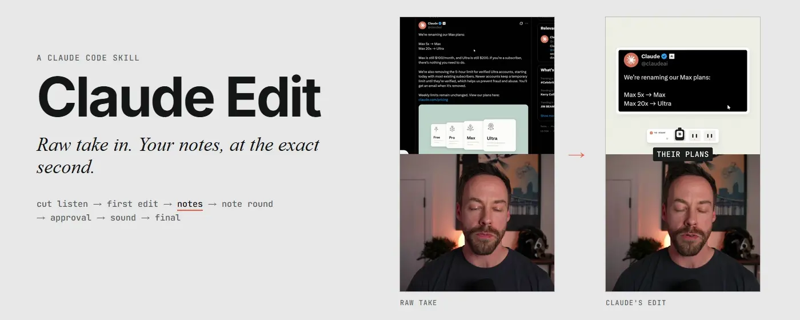</a>
</p>

<p align="center">
  <b>A Claude Code skill that edits your talking-head videos beat by beat.</b><br>
  You watch your own edit, pause on a frame and leave a note. Claude changes only what you noted.
</p>

<p align="center">
  
  
  
  
</p>

<p align="center">
  <a href="https://ctskool.github.io/claude-edit/"><b>Watch the gallery</b></a>
  &nbsp;·&nbsp;
  <a href="#how-an-edit-goes">How an edit goes</a>
  &nbsp;·&nbsp;
  <a href="#the-review-player">The player</a>
  &nbsp;·&nbsp;
  <a href="#start-here">Start here</a>
  &nbsp;·&nbsp;
  <a href="INSTALL.md">Install</a>
</p>

## At a glance

| | |
|---|---|
| **You give it** | A raw talking-head take (or several). Your screen on top, your face cam below, or just your face |
| **You get** | A finished MP4, vertical in today's ivory template: cut tight, every beat edited, captioned, sounded and mastered |
| **Your part** | One minute to listen to the cut, notes in the player wherever you want a change, then approve |
| **It stops for you** | After the cut, after every render, before sound, before the final. It never moves the picture while you're reviewing |
| **It never** | Invents a number, generates your body or face, or changes something you didn't note |

## Raw take in, edited video out

<table>
<tr>
<td width="44%" valign="top"><a href="https://ctskool.github.io/claude-edit/">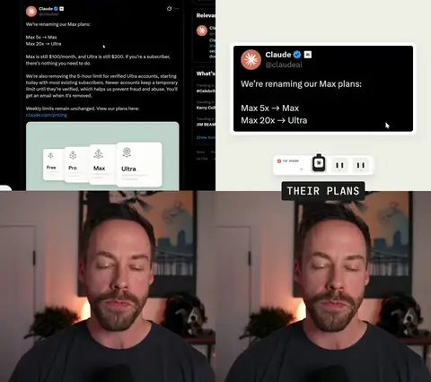</a></td>
<td valign="top">

```text
/claude-edit "C:/Users/you/Videos/take.mkv"
```

Left is the raw take. Right is the edit Claude made from it, on the same seconds with the same voice. This is a real short: 57 seconds, 29 beats, four rounds of notes, then approval, sound and the final. [Watch it with sound in the gallery](https://ctskool.github.io/claude-edit/).

- **It edits your real footage.** Your screen recording, your face cam, real screenshots of the pages you mention. It never invents a body, a face or a number.
- **Every number on screen has a source.** Claude checks each claim before it can appear, and anything it can't verify stays off the picture.
- **You react to a finished edit.** No picking styles or moves up front. You see the whole video edited, then say what to change.

</td>
</tr>
</table>

## How an edit goes

1. **Raw in.** Hand it one or more raw takes. Claude transcribes them on your computer, drops the failed takes, false starts and long pauses, and checks the cut by transcribing it again.
2. **The one-minute cut listen.** Claude sends you a phone-size copy of the cut and **stops**. Nothing gets built until you've listened and said it's right. While you listen, it already checks the facts and captures the pages you mention.
3. **The first edit.** Claude plans every beat: which words land on what, which real screenshot or clip shows it, where the layout switches. A second agent checks that plan before anything is built. Then the whole video is built in the ivory template and rendered at review quality.
4. **Its own defects round.** Two fresh reviewers look for broken frames, clipped text and anything that hides your face. Claude fixes what they find before you see it.
5. **Your notes, at exact seconds.** The review player opens in your browser. Pause where you want a change, press **N**, type. Each note is saved with the exact frame and the picture it was left on.
6. **The note round.** Say "go" in the chat. Claude maps each note to the one piece of source that drew that frame, changes only that, and re-renders only the beats it touched. Then you look again. Repeat as often as you like.
7. **Approval.** You approve in the player. Claude re-renders every beat fresh and compares each frame with the picture you approved, so nothing changed behind your back.
8. **Sound.** Claude places sound effects by what each moment does, levelled against your voice. You listen in the player and leave sound notes the same way.
9. **The final.** Built fresh from a frozen copy of the approved edit, mastered, checked again, and handed to you as an MP4.

Claude also turns your notes into candidate rules for next time. Nothing becomes a rule until you mark it keep.

Some stages are newer than others. Research during the cut listen, the parallel build and the component library are tested on stubs but haven't run on a real video yet; the table at the top of [SKILL.md](.claude/skills/claude-edit/SKILL.md) says which stage has.

## The review player

<p align="center">
  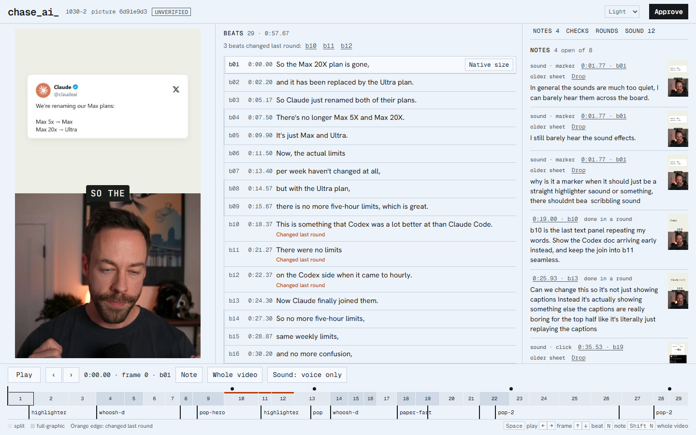
</p>

<table>
<tr>
<td width="56%" valign="top"><a href="https://ctskool.github.io/claude-edit/">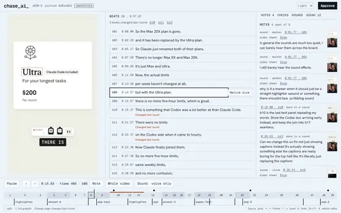</a></td>
<td valign="top">

- **The edit on the left, every beat in the middle, your notes on the right.** Click a beat to jump to it. The beats Claude changed last round are marked.
- **Notes stay attached to their frame.** If you go back to an earlier round, notes left on a later picture come back to you as questions, never applied silently.
- **Checks you can see.** Anything the automatic checks failed shows in the player. Only you can waive it, with a click.
- **A page can't wake Claude,** so you say "go" in the chat when your notes are ready.

The default look is the light grey above. Optional looks live in [`tools/beat_review_v2/skins/`](tools/beat_review_v2/skins): add `?skin=<name>` to the address.

</td>
</tr>
</table>

## What it reuses

Every approved edit adds the components it proved to a library, so the next edit can start from them. These came out of the edit above.

<!-- gallery:start -->

### Proven components

Each one came out of an approved edit, so the next edit can start from it. They live in templates/ivory/library/.

<table>
<tr>
<td width="33%" align="center" valign="top">
<a href="https://ctskool.github.io/claude-edit/">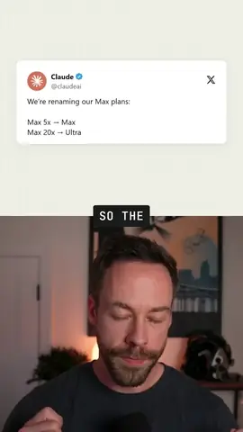</a>
<br><b>Post card</b><br><sub>The real post, rebuilt sharp on an ivory card, with the old name struck out</sub>
</td>
<td width="33%" align="center" valign="top">
<a href="https://ctskool.github.io/claude-edit/">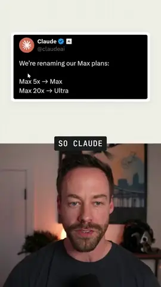</a>
<br><b>Clip card</b><br><sub>A piece of his own screen recording on a card, with the running strip popping in</sub>
</td>
<td width="33%" align="center" valign="top">
<a href="https://ctskool.github.io/claude-edit/">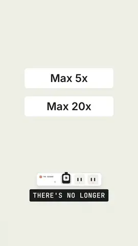</a>
<br><b>Before and after</b><br><sub>Two built pills for the old names, struck through as the new ones land</sub>
</td>
</tr>
<tr>
<td width="33%" align="center" valign="top">
<a href="https://ctskool.github.io/claude-edit/">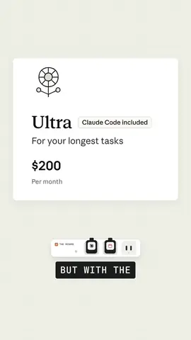</a>
<br><b>Stacked capture</b><br><sub>One real plan card from the pricing page, zoomed, with a drawn outline</sub>
</td>
<td width="33%" align="center" valign="top">
<a href="https://ctskool.github.io/claude-edit/">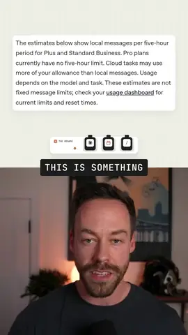</a>
<br><b>Docs card</b><br><sub>The real help page on a white card, one phrase outlined as he says it</sub>
</td>
<td width="33%" align="center" valign="top">
<a href="https://ctskool.github.io/claude-edit/">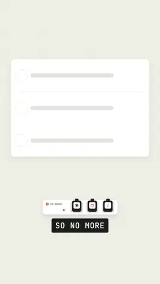</a>
<br><b>List card</b><br><sub>Rows that check off one by one, each with a crop of the real post</sub>
</td>
</tr>
<tr>
<td width="33%" align="center" valign="top">
<a href="https://ctskool.github.io/claude-edit/">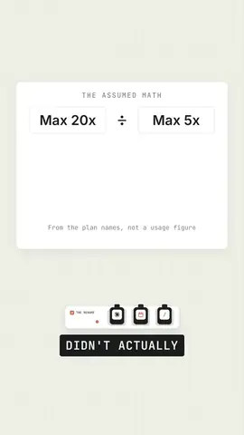</a>
<br><b>Number card</b><br><sub>An equation in pills and a big serif figure, struck when he corrects it</sub>
</td>
<td width="33%" align="center" valign="top">
<a href="https://ctskool.github.io/claude-edit/">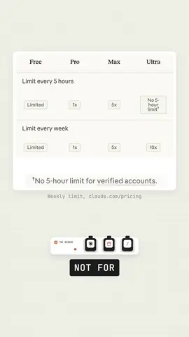</a>
<br><b>Compare table</b><br><sub>The real pricing table with pill outlines, a drawn bracket and its footnote</sub>
</td>
<td width="33%" align="center" valign="top">
<a href="https://ctskool.github.io/claude-edit/">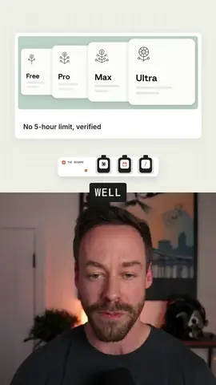</a>
<br><b>Art card</b><br><sub>The post's own art, pushing in on the new plan as he names it</sub>
</td>
</tr>
</table>

### Coming next

<table>
<tr>
<td width="33%" align="center" valign="top">
<sub><i>In note rounds now</i></sub>
<br><b>Top five skills</b><br><sub>The second edit through the whole flow, added once it's approved</sub>
</td>
</tr>
</table>

<!-- gallery:end -->

## Start here

You need Claude Code, Python 3.10+, Node.js 22+, ffmpeg and Chrome or Edge. [INSTALL.md](INSTALL.md) has the full steps for Windows and macOS.

```bash
git clone https://github.com/ctskool/claude-edit.git
```

```bash
cd claude-edit
```

```bash
python -m pip install -r requirements.txt
```

```bash
npm ci
```

```bash
python tools/doctor.py
```

Fix anything the doctor marks FAIL, then open Claude Code in this folder and type `/claude-edit` with the path to your raw take.

**What to record.** For today's vertical template, a vertical take with your screen in the top half and your face cam in the bottom half, the way Chase records in OBS. A separate full-quality camera file beside it is optional. A plain face-only take works too: say so at the start.

**Effects from Chase Animations.** `/animate` and `/vfx` come from the separate [Chase Animations](https://github.com/ctskool/chase-animations) pack, installed with its `npm run setup`. With it installed, a note in the player can call one, like "put the orbit here", and Claude drops its real render into that beat.

**Codex is optional.** With [Codex](https://github.com/openai/codex) installed, Claude can generate scene images and a second model joins the defects round. Without it, every beat uses real captures and built cards, and two Claude reviewers run instead.

## How it's built

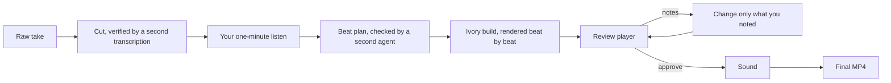

| Folder | What's in it |
|---|---|
| [`.claude/skills/claude-edit/`](.claude/skills/claude-edit/SKILL.md) | The skill: every stage, its checks and its stop points |
| [`templates/`](templates) | The house rules, the story rules for cutting, and the ivory template with its build kit, sound palette and component library |
| [`tools/`](tools) | The cutter, transcription, beat renderer, checks, review player, sound mixer and delivery |
| [`tools/workflows/next/`](tools/workflows/next) | The planning, build and sound workflows the skill runs |
| [`examples/ivory-edit/`](examples/ivory-edit) | The text files of the approved edit above: how a plan becomes an edit |
| [`styles/editorial/`](styles/editorial) | The measured look behind ivory |
| [`references/`](references) | How to measure a reel you like, so its ideas (not its look) can reach your edit |
| [`docs/`](docs) | The gallery page and its catalogue |
| [`scripts/`](scripts) | Builders for the gallery, banner and player capture. Not needed to edit |

## What works where

| | Status |
|---|---|
| Windows 11 | Tested. One raw take has gone the whole way, to an approved, sounded final |
| Mac | **Untested.** The paths and process handling are written for it and the doctor checks it, but nobody has run an edit on a Mac yet. [Open an issue](https://github.com/ctskool/claude-edit/issues) and say how it goes |
| Linux | Untested |
| Widescreen | Ships with a vertical template today; a widescreen template is next. The ivory template, `prep_source.py` and the checks assume 1080x1920 |
| A first run by someone else | Not done yet. Expect rough edges, and run `python tools/doctor.py --fix-hints` first |

The status of every stage, from "works" to "not built", is in the table at the top of [SKILL.md](.claude/skills/claude-edit/SKILL.md).

## License

MIT, see [LICENSE](LICENSE). The notices for the bundled fonts and GSAP are in [`licenses/`](licenses). Claude and Claude Code are Anthropic's, and this project isn't affiliated with or endorsed by Anthropic.
