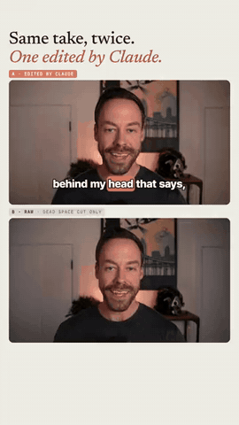
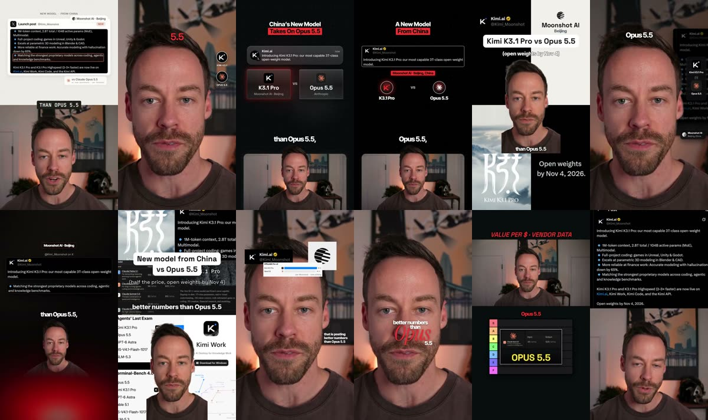

# claude-edit

**Hand Claude Code a talking-head recording, get back motion-graphics shorts.** One take goes in; out come several
differently-designed 9:16 edits (transcript-synced graphics, real screenshots of what you talk about, captions, sound
design), rendered locally with [HyperFrames](https://github.com/heygen-com/hyperframes). Pick the versions you like,
post them, and compare which one works.

<p align="center"></p>

**[See every version in the gallery](https://ctskool.github.io/claude-edit/)** (or open `docs/index.html`).



## What it does

- **Tight-cuts raw takes**: keeps the last good take of each line, trims dead air, then re-transcribes the result and
  checks it word for word against the script.
- **Researches before it designs**: facts are checked on the live web, and real screenshots of the repos, pages and
  posts you mention are captured in light and dark. It never puts a number on screen that it could not source.
- **Plans the edit once and renders it in every look**: a style-agnostic beat plan goes through each style and format
  you ask for. Critic panels review each render, and a skeptic has to confirm a problem in the frames before anything
  gets "fixed".
- **Raw vs Claude** (`/claude-edit-versus`): film one take where you ask for edits out loud. Claude lands each edit on
  the word that names it, with the untouched take running underneath for comparison.

## The menu

| menu name | what it is | shortcut |
|---|---|---|
| **ivory** (default) | split screen, ivory + clay graphics on top, serif headlines, rebuilt interface cards | `/claude-edit-ivory` |
| **versus** | Raw vs Claude A/B: edits land on the word you name them | `/claude-edit-versus` |
| **cut** | just the tight cut of your raw takes | `/claude-edit-cut` |
| rotation | face / split / full-screen animation rotation | `/claude-edit-rotation` * |
| frost | you in a rounded panel, frosted glass cards above | `/claude-edit-frost` * |
| popout | you in a panel at the bottom, head popping above it | `/claude-edit-popout` * |
| mosaic | cut-out over a 2x2 grid of tiles | `/claude-edit-mosaic` * |
| layers | full frame, real interfaces behind your head | `/claude-edit-layers` * |
| evidence | cut-out low, an evidence wall of real posts | `/claude-edit-evidence` * |
| scenes | cut-out over one full-screen image per idea | `/claude-edit-scenes` * |
| collage | image cards above your head | `/claude-edit-collage` * |
| wrap | caption layer: big anchor word, small words fitted around it | `/claude-edit-wrap` * |
| tiers | tier list (only for videos that rank things) | `/claude-edit-tiers` * |

\* Layout formats: these need your own copy of the **Creator Skill Pack**, which is not included here because its licence
does not allow redistribution. One command imports it and patches it for Windows and macOS (see Install, step 4).

## Install

You need [Claude Code](https://claude.com/claude-code), Python 3.10+ (3.11-3.13 recommended), Node.js 22+ and
ffmpeg. `setup.py` checks all of them and offers to install what is missing.

**Windows** (PowerShell):

```powershell
git clone https://github.com/ctskool/claude-edit.git
cd claude-edit
py -3 setup.py --smoke
claude
```

**macOS** (Terminal; Homebrew recommended):

```bash
git clone https://github.com/ctskool/claude-edit.git
cd claude-edit
python3 setup.py --smoke
claude
```

What `setup.py` does:
1. Detects your OS and GPU (NVIDIA, Apple Silicon or CPU only).
2. Installs or checks ffmpeg (winget / Homebrew, asking first), Node and the pinned HyperFrames 0.8.184 (npm), and the
   Chrome that HyperFrames renders with.
3. Creates `.venv` with faster-whisper and friends, plus torch for your GPU (CUDA wheels on NVIDIA, MPS on Apple Silicon,
   CPU wheels otherwise).
4. Downloads the Robust Video Matting cut-out model (code + weights, checksum-verified).
5. Writes `config/config.json` with the encoder (NVENC, VideoToolbox or x264), the Whisper device and the cut-out device.
6. With `--smoke`, runs a 5-second end-to-end test: encode, cut-out, Whisper, HyperFrames render. Re-running is safe.
   `--check` only reports. `--no-matte` skips the ~2 GB torch install (ivory and cut still work).

Then, inside Claude Code:

1. `/claude-edit-setup` asks for your brand (name, handle, colours, fonts) and writes `config/profile.json`.
2. `/claude-edit my-video.mp4` makes your first edit.
3. Optional, for the layout formats: `python setup.py --import-pack "<path to Creator-Skill-Pack>/skills"`.

**Platform status:** developed and tested on Windows 11 with an RTX 5090: setup plus smoke test pass, and the Raw vs
Claude render reproduces the hand-built original (PSNR 49.8 dB). **The macOS paths are implemented but have not been run on a Mac yet**
(VideoToolbox encode, MPS cut-out, Homebrew installs). Please open an issue with the output of `python3 setup.py --smoke`.

**Speed** (50 s short, RTX 5090): tight cut ~1 min, cut-out ~40 s, each HyperFrames render 2-8 min, the full plan +
build + review loop 3-4 hours of agent time. Apple Silicon is slower; on a CPU-only machine the cut-out formats and
Raw vs Claude take much longer (the cut-out runs at a few frames per second).

## Prompt examples

```text
/claude-edit my-video.mp4                          ivory only (the default)
/claude-edit my-video.mp4 ivory and rotation       two versions to A/B
/claude-edit my-video.mp4 ivory + all formats      everything that fits the video
/claude-edit-cut take1.mkv take2.mkv               just the verified tight cut of raw takes
/claude-edit-mosaic my-video.mp4                   one format, nothing else
/claude-edit-versus take.mkv                       Raw vs Claude from one 16:9 take
/claude-edit-setup                                 install check + brand questions ("redo my setup" works too)
```

More, including follow-ups such as "polish the rotation version" and "the captions cover my mouth at 0:12":
[examples/prompts.md](examples/prompts.md).

## What to film

- **Split screen** (best for ivory): a 9:16 recording with your screen on top and your face cam below, e.g. an OBS
  vertical scene. Raw takes are fine; `/claude-edit` cuts them.
- **Camera only**: a 16:9 talking-head take. Landscape footage is detected automatically.
- **Raw vs Claude**: one 16:9 take, camera only. Say the edits out loud in order, and finish with a line that lands it.
- For the full-frame formats (layers, wrap, evidence), sit a little further back: your chin about 60% down the frame.

## How it works

```text
raw takes --rawcut.py--> cut.mp4 --prep_source.py--> face crops + words.json
   --recut-plan workflow--> facts.json (live-web verified) + screenshots + beats.json (content plan)
   --recut-build workflow--> one HyperFrames project per style/format --render.py--> out/<id>_<style>_v1.mp4
   --gauntlet-panel workflow--> 3 critics + skeptic verification + fixer --> v2, v3 ... until SHIP
```

| folder | what |
|---|---|
| `.claude/skills/` | `/claude-edit`, its shortcuts, `/claude-edit-versus`, `/claude-edit-setup`, and the HyperFrames skills it builds on |
| `tools/` | the Python tools (cut, prep, transcribe, cut-out, render, gates, versus) and the multi-agent workflows |
| `styles/`, `templates/` | the ivory style rules and measured component kits, and the proven project each build adapts |
| `formats-kit/` | docs + defaults for the imported layout formats (`formats/` itself is git-ignored) |
| `config/` | `config.json` (machine, written by setup) and `profile.json` (your brand), both git-ignored |
| `docs/` | the gallery (GitHub Pages) |

## Licences

Code in this repo is MIT ([LICENSE](LICENSE)), except `tools/matte.py`, which is GPL-3.0 because it imports Robust Video
Matting. What is bundled and what is downloaded at setup: [THIRD_PARTY.md](THIRD_PARTY.md). Gallery videos show the
author and are for demonstration only.

Made by [Chase AI](https://www.instagram.com/chase.h.ai/) with Claude Code.
